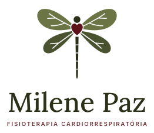

# Milene Paz

Identidade visual da **Fisioterapeuta Milene Paz**, especialista em fisioterapia cardiorrespiratória. A marca une o cuidado com o coração e os pulmões à leveza da libélula — um símbolo de transformação, equilíbrio e da capacidade de recomeçar.

## O conceito

O símbolo é uma libélula desenhada a partir do sistema cardiorrespiratório:

- **As asas são os pulmões.** De cada lado, a asa superior e a inferior formam os dois lobos de um pulmão; o espaço entre elas é a fissura.
- **As nervuras são os brônquios.** Cada asa é cortada por um tronco que se ramifica, como a árvore brônquica levando o ar.
- **O tórax é um coração**, em vinho — o único ponto quente do desenho, para onde o olhar vai primeiro.
- **O abdômen segmentado** lembra a traqueia e o ritmo, compasso a compasso, da respiração.

A libélula também carrega o significado que a Milene oferece a quem atende: atravessar uma fase difícil e sair mais leve.

## Personalidade e voz

Acolhedora, técnica sem ser fria, serena. A marca fala como uma profissional que explica com calma e transmite segurança.

- **Escreva em segunda pessoa**, com proximidade: "Vamos cuidar da sua respiração", não "O paciente será submetido a…".
- **Termos técnicos com tradução**: "reabilitação pulmonar — exercícios para o pulmão voltar a trabalhar bem".
- **Frases curtas e positivas**, sem alarmismo. Fale de qualidade de vida, autonomia, fôlego.
- **Chamadas de ação diretas**: "Agendar avaliação", "Falar no WhatsApp".
- Evite emojis em excesso, exclamações em série e imagens de hospital frias.

## Logotipo

| Versão | Quando usar |
|---|---|
| Horizontal | Padrão: site, cabeçalho, assinatura de e-mail, receituário. |
| Vertical | Espaços quadrados ou estreitos: jaleco, cartão, capa de documento. |
| Horizontal creme | Sobre fundos escuros: `oliva-900`, `oliva-700`, `vinho-700`, `vinho-900`. |
| Símbolo | Favicon, marca-d'água, carimbos e onde o nome já aparece por perto. |
| Avatar | Foto de perfil no Instagram, WhatsApp e Google. |

**Área de proteção:** mantenha ao redor do logotipo um espaço livre igual à altura do coração do símbolo.
**Tamanho mínimo:** símbolo com 24px (digital) ou 8mm (impresso); logotipo horizontal com 140px ou 35mm de largura.

**Não faça:** mudar as cores das asas, separar o coração da libélula, girar o símbolo, aplicar sombra ou contorno, colocar a versão colorida sobre fotos ou fundos escuros (use a creme), esticar ou comprimir.

## Cores

A paleta é de duas famílias, oliva e vinho, sobre um creme quente que substitui o branco.

- **Oliva** (`oliva-900` → `oliva-100`) é a cor da natureza, do ar e da calma. Domina as superfícies e o texto: `ink` é o `oliva-900`.
- **Vinho** (`vinho-900` → `vinho-500`) é o coração. Use pouco e com intenção: ação principal (`accent`), destaques, o coração do símbolo. Em uma peça, o vinho ocupa no máximo 15% da área — salvo em peças de impacto, como o avatar.
- **Creme** (`creme`, `papel`) é o fundo de tudo. Evite branco puro e preto puro.

Proporção sugerida em peças: 60% creme · 25% oliva · 15% vinho.

Contraste: todo texto pequeno usa `ink`, `ink-muted`, `oliva-700` ou `accent` sobre `surface`; sobre fundos escuros, `on-accent`. O `oliva-500` só vira texto a partir de 24px.

## Tipografia

- **Lora** (serifada caligráfica) para títulos, o nome e citações — traz a delicadeza e o lado humano. Peso 500 nos títulos; itálico para depoimentos (`citacao`).
- **Inter** (sem serifa) para textos, botões e rótulos — clareza e leitura fácil no celular. `body` nunca abaixo de 16px no site.
- O **sobretítulo** (`label`) repete o estilo do logotipo: Inter 600, caixa alta, espaçamento 0,16em, em `accent` ou `ink-muted`.

## Formas e padrão

- Cantos arredondados e generosos (`radius-md`, `radius-lg`); botões em cápsula (`radius-pill`), como a forma da asa.
- Superfícies chapadas, sem gradientes. Sombra só a `shadow-soft`, raramente.
- **Padrão de libélulas:** pequenas libélulas em tom sobre tom (`oliva-100` sobre `creme`), para fundos de seções, papelaria e stories. Nunca atrás de texto pequeno.

## Imagens e ícones

- **Fotografia:** luz natural, tons quentes, a Milene em atendimento real, gestos de cuidado, respiração ao ar livre, plantas. Evite fotos de banco de imagem com ambiente hospitalar frio e azul.
- **Ícones:** traço fino (1,5px), cantos arredondados, em `oliva-700` ou `accent`. Um único estilo de linha em todo o material.

## Aplicações

Veja os exemplos em Componentes: botões do site, cartão de visita e post para o Instagram. A próxima etapa é a landing page para captação de pacientes, construída com estes tokens.
